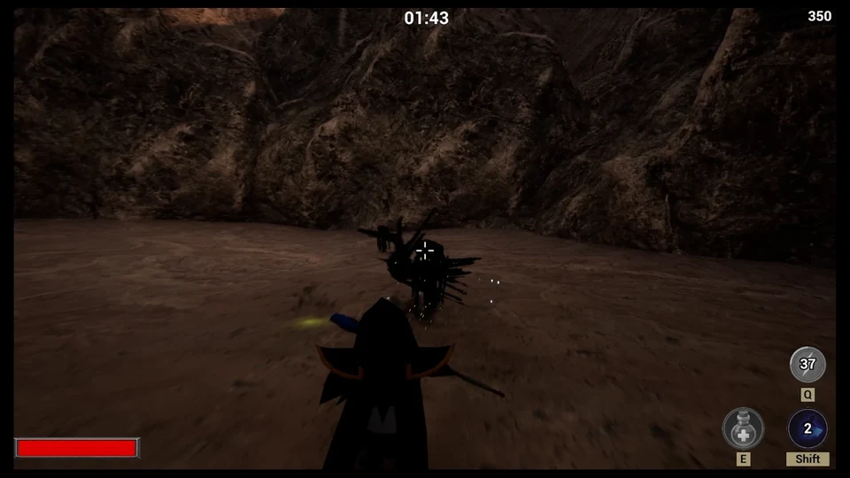

# DAEVA — 3분 생존 TPS

> Unreal Engine 5.4 · C++ · **1인 개발**

악마에게 맞서 홀로 살아남은 떠돌이 마법사가 되어, 제한된 맵에서 점점 많아지는 몬스터를 상대로 **3분 동안 버티는** 3인칭 생존 게임입니다.

<!-- TODO: 플레이 영상 링크로 바꿔 주세요 -->
**▶ 플레이 영상:** [YouTube](https://youtube.com/)
**🌐 소개 페이지:** https://juni4268.github.io/daeva/

---

## 게임 구성
| 항목 | 내용 |
|---|---|
| 장르 | TPS / 생존 |
| 목표 | 180초 동안 살아남기 (최대 체력 5) |
| 조작 | WASD 이동, 마우스 시점, 좌클릭 기본 공격, Shift 순간이동, Q 범위 스킬, E 회복 포션 |
| 적 | 일반 몬스터(피해 1), 정예 몬스터(피해 2) |

## 주요 구현 내용

### 1. 플레이어 스킬 — [`Arusa.cpp`](Source/Daeva/Arusa.cpp)
| 스킬 | 구현 |
|---|---|
| 기본 공격 | 마법 투사체를 발사합니다([`Arrow.cpp`](Source/Daeva/Arrow.cpp)). 맞으면 `OverlapMultiByChannel`로 반경 200 안의 적에게 **범위 피해와 스턴**을 줍니다 |
| Shift 순간이동 | 앞쪽 800 지점으로 `TeleportTo`합니다. 막혀서 실패하면 높이를 올려 다시 시도하고, 출발과 도착 지점에 이펙트를 냅니다. 쿨타임은 20초입니다 |
| Q 범위 스킬 | 발밑에 마법진을 깔고, 2초 뒤 폭발하면서 반경 1200 안의 적을 처치합니다(피해 1000). 지연 처리는 타이머 람다로 구현했고, 쿨타임은 45초입니다 |
| E 회복 포션 | 맵에서 포션을 얻어야 사용할 수 있고, HP를 1 회복합니다 |

- 각 스킬의 쿨타임은 UI 게이지와 활성/비활성 아이콘으로 표시합니다.

### 2. 몬스터 AI — [`MonsterAI.cpp`](Source/Daeva/MonsterAI.cpp)
- 컴포넌트 기반 상태 머신(`Idle → Move → Damage → Death`)으로 구성했습니다.
- 생성되면 플레이어를 추적하고, 공격 사거리에 들어오면 공격합니다. 애니메이션 상태는 [`MonsterAnim`](Source/Daeva/MonsterAnim.cpp)과 동기화합니다.
- 일반 몬스터와 정예 몬스터는 [`AMonster`](Source/Daeva/Monster.h)를 상속해 구현했습니다([`MonsterSevarog`](Source/Daeva/MonsterSevarog.cpp), [`MonsterBoss`](Source/Daeva/MonsterBoss.cpp)).

### 3. 난이도 곡선 — [`MonsterSpawnManager.cpp`](Source/Daeva/MonsterSpawnManager.cpp)
- 맵에 놓인 스폰 포인트 중 하나를 무작위로 골라 몬스터를 생성합니다.
- 경과 시간에 따라 생성 간격을 좁힙니다: 2.5–3초 → 60초 이후 2–3초 → 120초 이후 2–2.5초 → 150초 이후 1.5–2.5초. 후반으로 갈수록 몬스터가 몰려옵니다.
- 포션은 [`ItemSpawnManager`](Source/Daeva/ItemSpawnManager.cpp)가 아이템 스폰 포인트에 타이머로 생성합니다. 생성 간격은 에디터에서 조절하며, 기획 기준은 맵 중앙에 1분 간격입니다.

### 4. 게임 흐름 / UI
- [`Timer`](Source/Daeva/Timer.cpp)는 180초 카운트다운을 하고, 끝까지 살아남으면 게임 클리어입니다.
- 처치 수만큼 포인트를 쌓아 결과 화면에 표시합니다.
- [`TitleManager`](Source/Daeva/TitleManager.cpp)는 타이틀 → 게임 → 클리어/오버 → 재시작/종료 흐름을 담당합니다.
- UI 위젯: [`HpWidget`](Source/Daeva/HpWidget.cpp), [`SkillWidget`](Source/Daeva/SkillWidget.cpp), [`SprintWidget`](Source/Daeva/SprintWidget.cpp), [`PotionWidget`](Source/Daeva/PotionWidget.cpp), [`PointWidget`](Source/Daeva/PointWidget.cpp), [`GamemanagerWidget`](Source/Daeva/GamemanagerWidget.cpp)

---

## 참고
- 이 저장소에는 **코드와 설정만** 포함되어 있습니다. 캐릭터, 몬스터, 환경, 이펙트 등은 마켓플레이스 에셋을 사용해서 라이선스상 포함하지 않았습니다. 그래서 이 저장소만으로는 에디터에서 프로젝트를 열 수 없습니다.
- 원본 소스의 주석 인코딩(CP949)을 GitHub에서 읽을 수 있도록 UTF-8로 변환했습니다. 코드 내용은 바꾸지 않았습니다.
- 엔진: Unreal Engine 5.4
