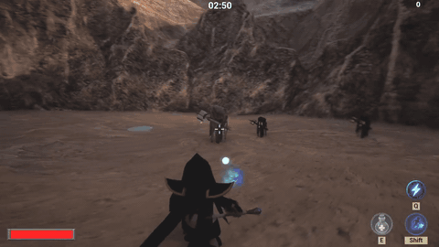

# DAEVA

떠돌이 마법사가 되어 점점 늘어나는 몬스터를 상대로 3분간 버티는 3인칭 생존 게임입니다.

- 영상과 구현 설명: https://juni4268.github.io/daeva/

## 개요

| | |
|---|---|
| 엔진 | Unreal Engine 5.4 · C++ |
| 시점 | 3인칭 |
| 기간 | 2025년 4월~6월 (3개월) |
| 인원 | 1인 제작 |
| 담당 | 기획, 프로그래밍, UI 제작 |

## 구현 내용

소개 페이지에서 영상과 함께 설명하는 부분입니다.

### 시간이 갈수록 몰려오는 몬스터

몬스터는 맵에 놓아 둔 생성 지점 중 한 곳에서 무작위로 나옵니다. 생성 간격은 경과 시간에 따라 네 단계로 줄어들고, 정예 몬스터는 시작할 때 한 마리, 그 뒤로 1분마다 한 마리씩 추가로 나옵니다.

코드: [`MonsterSpawnManager.cpp`](Source/Daeva/MonsterSpawnManager.cpp)

### 몬스터 AI

몬스터의 행동을 대기, 이동, 피격, 사망 네 가지 상태로 나눴습니다. 플레이어까지 가는 길이 있으면 플레이어를 쫓고, 길이 없으면 주변의 임의 지점으로 움직입니다. 공격 거리 안에 들어오면 멈춰서 공격합니다.

코드: [`MonsterAI.cpp`](Source/Daeva/MonsterAI.cpp)

### 플레이어 스킬

기본 공격은 맞은 대상과 그 주변의 몬스터에게 함께 피해를 줍니다. 순간이동은 도착 지점이 막혀 있으면 위로 올려 한 번 더 시도합니다. 범위 스킬은 발밑에 마법진을 깔고 2초 뒤 그 자리에서 폭발합니다.

코드: [`Arusa.cpp`](Source/Daeva/Arusa.cpp), [`Arrow.cpp`](Source/Daeva/Arrow.cpp)

## 조작

| 동작 | 키 |
|---|---|
| 이동 | W A S D |
| 시점 | 마우스 |
| 기본 공격 | 마우스 왼쪽 버튼 |
| 순간이동 | Shift |
| 범위 스킬 | Q |
| 회복 포션 | E |

## 그 외 코드

몬스터, 아이템, 게임 흐름, UI

| 내용 | 위치 |
|---|---|
| 몬스터(일반, 정예) | [`Monster.cpp`](Source/Daeva/Monster.cpp), [`MonsterSevarog.cpp`](Source/Daeva/MonsterSevarog.cpp), [`MonsterBoss.cpp`](Source/Daeva/MonsterBoss.cpp) |
| 몬스터 애니메이션 | [`MonsterAnim.cpp`](Source/Daeva/MonsterAnim.cpp) |
| 플레이어 애니메이션 | [`PlayerAnimInstance.cpp`](Source/Daeva/PlayerAnimInstance.cpp) |
| 포션과 포션 생성 | [`Item.cpp`](Source/Daeva/Item.cpp), [`ItemPotion.cpp`](Source/Daeva/ItemPotion.cpp), [`ItemSpawnManager.cpp`](Source/Daeva/ItemSpawnManager.cpp) |
| 3분 타이머와 클리어 | [`Timer.cpp`](Source/Daeva/Timer.cpp), [`DaevaGameModeBase.cpp`](Source/Daeva/DaevaGameModeBase.cpp) |
| 타이틀 화면 | [`TitleManager.cpp`](Source/Daeva/TitleManager.cpp) |
| 결과 화면 | [`GamemanagerWidget.cpp`](Source/Daeva/GamemanagerWidget.cpp) |
| UI(체력, 스킬, 순간이동, 포션, 점수) | [`HpWidget.cpp`](Source/Daeva/HpWidget.cpp), [`SkillWidget.cpp`](Source/Daeva/SkillWidget.cpp), [`SprintWidget.cpp`](Source/Daeva/SprintWidget.cpp), [`PotionWidget.cpp`](Source/Daeva/PotionWidget.cpp), [`PointWidget.cpp`](Source/Daeva/PointWidget.cpp) |

## 이 저장소에 대해

포트폴리오용으로 **코드와 설정만** 공개합니다. 캐릭터, 몬스터, 맵, 이펙트는 마켓플레이스 에셋이라 포함하지 않았고, 이 저장소만으로는 에디터에서 프로젝트를 열 수 없습니다. 원본 소스의 주석 인코딩(CP949)은 GitHub에서 읽을 수 있도록 UTF-8로 바꿨고, 코드 내용은 바꾸지 않았습니다.

- `Source/Daeva` — 게임 코드
- `Config` — 프로젝트 설정
- `Daeva.uproject` — 엔진 버전과 플러그인
